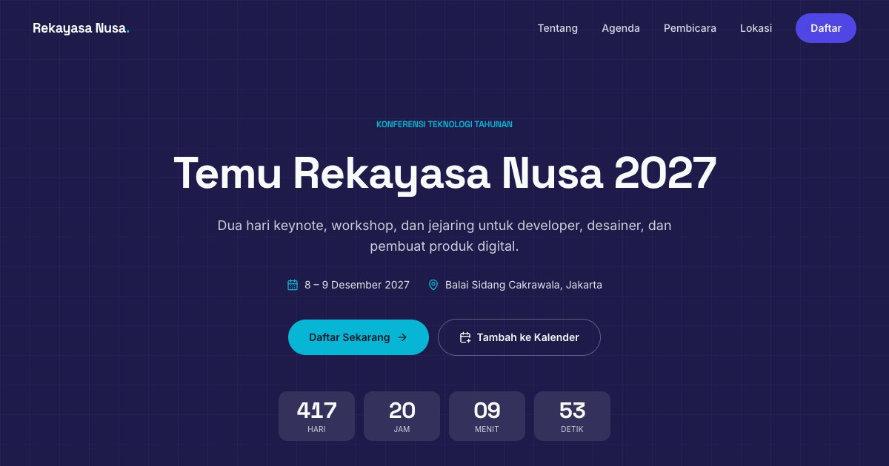

# Situs Acara — Temu Rekayasa Nusa 2027

Situs konferensi, bukan undangan bersampul: navbar sticky, hero dengan hitung mundur, agenda dua hari bertab, pembicara, slot logo sponsor per tingkat, venue, dan formulir pendaftaran.

**Demo live:** https://undangan-corporate.pintuweb.id



> Contoh dengan data fiktif: nama, tempat, dan nomor rekening tidak sungguhan. Formulir hanya demo dan mengatakannya terus terang. Potret pembicara adalah ilustrasi buatan sendiri dan foto aula berlisensi CC0; keduanya siap diganti.

## Fitur

- Agenda dua hari (tab yang bisa dioperasikan papan ketik)
- Statistik dihitung otomatis dari agenda & pembicara
- Pembicara, slot sponsor berlabel, lokasi
- Pendaftaran peserta — mode demo, terus terang tidak memproses data
- Halaman 404 bergaya sendiri

## Mengganti isi

Seluruh isi ada di satu file: `lib/data.js` (nama, tanggal, acara, galeri, musik, agenda, pembicara, sponsor). Komponen tidak perlu disentuh.

- **Tanggal:** ubah teks tanggal *dan* nilai ISO (`mainDate`, `start`, `end`) — hitung mundur dan tombol kalender memakai nilai ISO.
- **Peta:** contoh menunjuk area kota; ganti `q=` di `location.mapEmbed` dan `mapLink` dengan nama tempat atau koordinat.
- **Foto:** timpa berkas di `public/images/` dengan nama yang sama (potret 3:4, atau persegi untuk berkas yang memang persegi).

## Gambar & kredit

- `public/images/pembicara-*.webp` — potret ilustrasi buatan sendiri (tokoh fiktif), digambar dari SVG.
- `public/images/venue-aula.webp` — foto CC0; judul, pembuat, dan sumbernya di `public/images/SUMBER.md`.


## Teknologi

- Next.js 15.5 (App Router) dan React 19
- Tailwind CSS v4 (token tema di `app/globals.css`)
- Framer Motion, lucide-react
- Font: Space Grotesk, Inter (next/font)
- SEO: metadata, Open Graph, JSON-LD (WebSite), sitemap.xml, robots.txt

## Menjalankan secara lokal

```bash
npm install
npm run dev
```

Buka http://localhost:3000.

---

Bagian dari koleksi 8 undangan digital di [PortalUndangan](https://www.pintuweb.id/undangan-digital). Dibuat oleh [PintuWeb](https://www.pintuweb.id), jasa pembuatan website.
